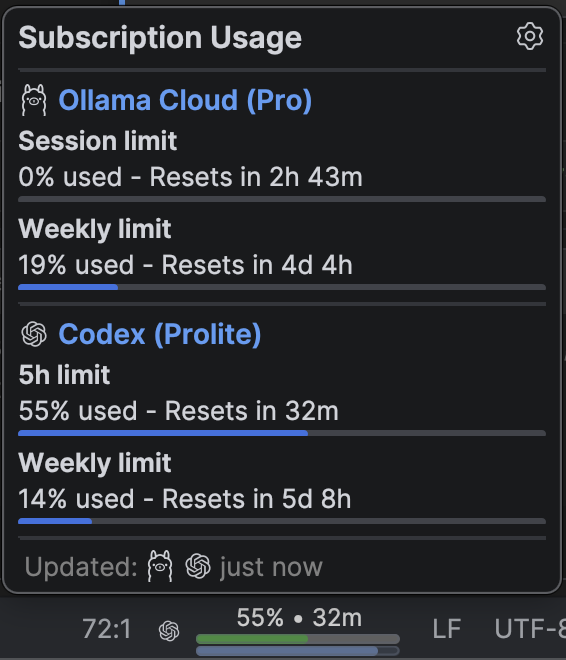
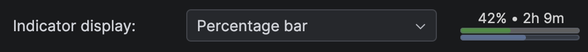
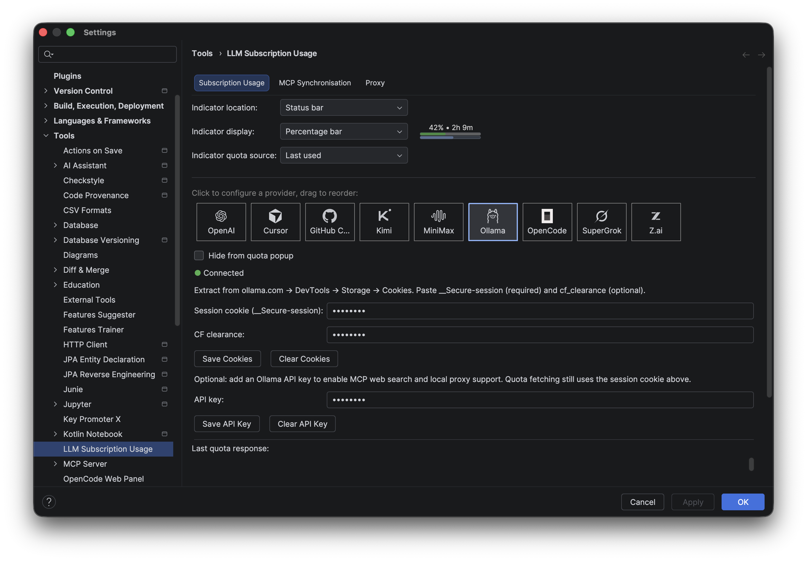
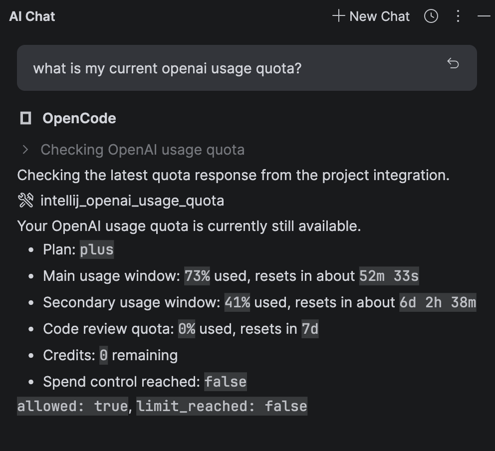
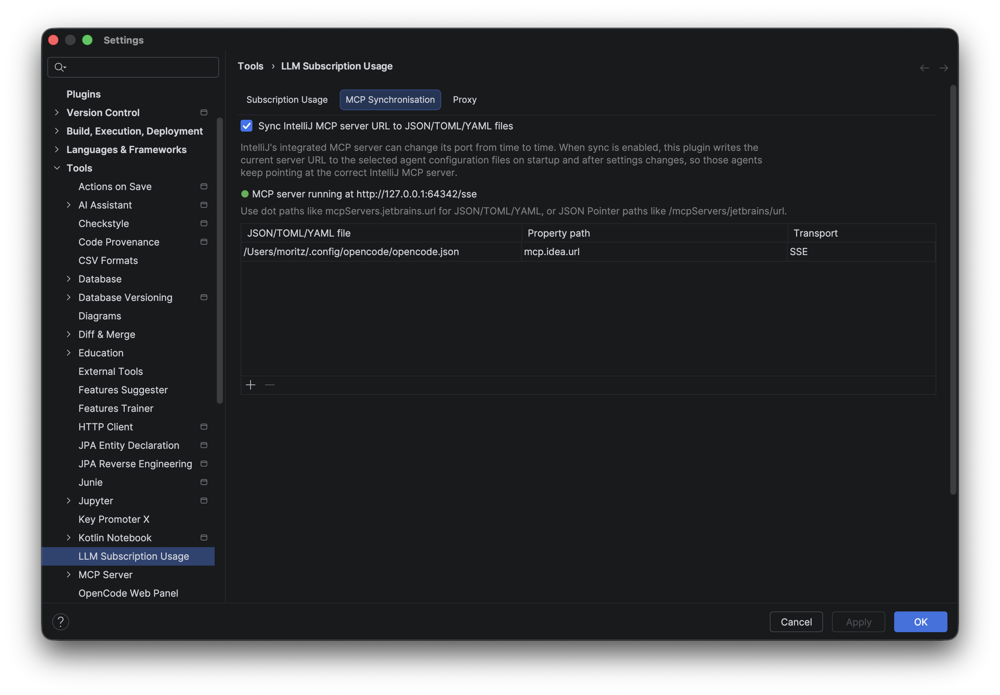
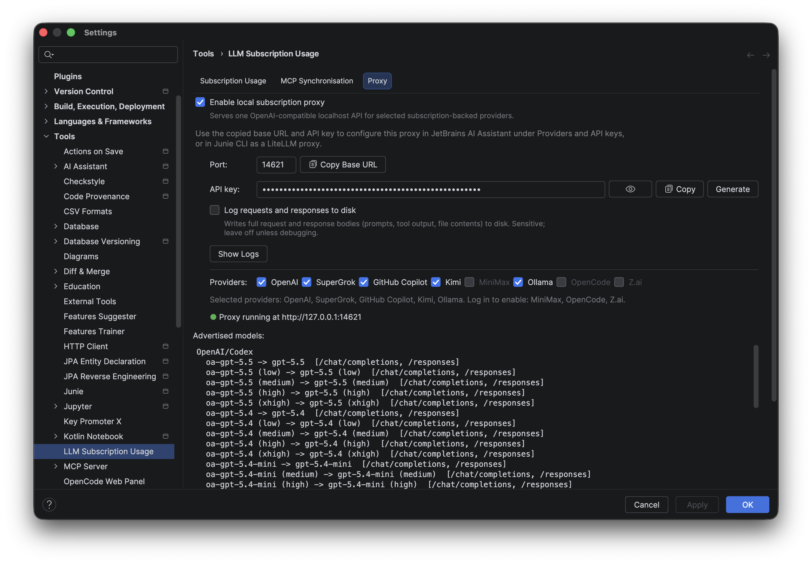

# LLM Subscription Usage

<table align="center">
  <tr>
    <td align="center">
      <a href="https://plugins.jetbrains.com/plugin/30690-openai-usage-quota">
        
      </a>
      <br />
      <strong><a href="https://plugins.jetbrains.com/plugin/30690-openai-usage-quota">LLM Subscription Usage on JetBrains Marketplace</a></strong>
      <br />
      <br />
      <a href="https://plugins.jetbrains.com/plugin/30690-openai-usage-quota">
        
      </a>
      <a href="https://plugins.jetbrains.com/plugin/30690-openai-usage-quota">
        
      </a>
      <a href="https://plugins.jetbrains.com/plugin/30690-openai-usage-quota">
        
      </a>
    </td>
  </tr>
</table>

Track and use your LLM subscriptions directly in IntelliJ IDEA.

- **See your quota** for ChatGPT, Claude, Grok, Copilot & more in the status bar and a detail popup.
- **Use your subscriptions from IDE chat** for web search, media generation, document conversion, and image questions via MCP tools.
- **Reuse your subscriptions in other tools** through a local OpenAI-compatible proxy, including JetBrains AI Chat and Junie.
- **Keep AI client configs in sync** with IntelliJ's MCP server URL, which changes port between restarts.



## Supported providers

| Provider | Sign-in | Quota | Web search | Images | Video | Voice | Docs | Vision | Proxy | Native FIM |
|---|---|:-:|:-:|:-:|:-:|:-:|:-:|:-:|:-:|:-:|
| OpenAI (ChatGPT / Codex) | Browser / device code / access token | ✓ | ✓ | ✓ | — | (✓) | (✓) | ✓ | ✓ | — |
| Claude (Anthropic) | Browser login | ✓ | — | — | — | — | — | — | — | — |
| SuperGrok / xAI | Browser / device code | ✓ | ✓ | ✓ | ✓ | ✓ | (✓) | ✓ | ✓ | — |
| GitHub Copilot | Device code | ✓ | — | — | — | — | (✓) | ✓ | ✓ | ✓ |
| Cursor | Session cookie | ✓ | — | — | — | — | — | — | — | — |
| OpenCode (Go / Zen) | Device code | ✓ | — | — | — | — | (✓) | ✓ | ✓ | — |
| Ollama Cloud | API key | ✓ | ✓ | — | — | — | — | ✓ | ✓ | ✓ |
| Z.ai | API key | ✓ | ✓ | ✓ | ✓ | (✓) | ✓ | ✓ | ✓ | — |
| MiniMax | Subscription key | ✓ | ✓ | ✓ | — | ✓ | — | — | ✓ | — |
| Mistral | Session cookie + API key | ✓ | ✓ | ✓ | — | ✓ | ✓ | ✓ | ✓ | ✓ |
| Kimi | Device code | ✓ | ✓ | — | — | — | — | ✓ | ✓ | — |
| Antigravity (Gemini / Claude / GPT) | AGY CLI login | ✓ | — | — | — | — | — | — | — | — |
| Azure OpenAI / Foundry | Azure CLI login | ✓ | — | — | — | — | ✓ | ✓ | ✓ | — |

Availability depends on your account and selected model. Search, media, documents, and vision are exposed through MCP.

- **Voice** — speech-to-text and text-to-speech; (✓) means speech-to-text only. Experimental OpenAI speech output is not counted here.
- **Docs** — PDF/image-to-Markdown conversion. ✓ uses a dedicated document/OCR service; (✓) requires a **general-purpose model that accepts PDF files natively**. Image/vision support alone is insufficient for PDF conversion.
- **Vision** — image questions through an image-capable model. PDF support is not required. Select a separate **Vision model** in settings; it is off (`-`) by default.
- **Proxy / Native FIM** — chat and inline code completion in other tools. Native FIM uses a model's own infill support; other eligible models use chat adaptation.

Claude, Cursor, and Antigravity are quota-only.

## Quick start

1. Install **LLM Subscription Usage** from `Settings` > `Plugins` > `Marketplace`.
2. Open `Settings` > `Tools` > `LLM Subscription Usage` and add your accounts.
3. Sign in or enter the requested credentials. Your quota appears in the status bar; click it for details.

MCP tools, server URL sync, and the local proxy are optional and configured on the same settings page.

## Quota tracking

Hover over the status bar widget for a summary, or click for usage windows, reset times, and refresh timestamps. You can also place the indicator in the main toolbar.

  

Quotas refresh every five minutes, on login, and when opening the popup. Use **Refresh quota** in an account's settings for an immediate update; **Last quota response** shows the provider's original response.

Add multiple logins and drag to reorder them in settings; the popup follows that order. Account changes take effect on **Apply**. Plugin-managed credentials are stored in IntelliJ Password Safe.



### CLI-backed accounts

- **Antigravity:** Install [AGY CLI](https://antigravity.google/docs/cli/install/) 1.1.11 or later, sign in with `agy`, then add Antigravity in settings. It tracks the current CLI account's quota.
- **Azure:** Install the [Azure CLI](https://learn.microsoft.com/en-us/cli/azure/install-azure-cli), run `az login`, then select your subscription and resource in settings. Proxy model IDs are `az-<deployment-name>`. Quota reading needs **Cognitive Services Usages Reader**; proxy use does not require that quota permission.

Each uses its own CLI login and supports one plugin entry. Set the executable path only if automatic detection fails. Azure model access depends on the selected resource and your permissions.

## MCP tools for IDE chat

Enable IntelliJ's built-in MCP server to make these tools available to connected AI clients, including IDE chat, Codex CLI, and OpenCode. Manage individual tools under `Settings` > `Tools` > `MCP Server` > `Exposed Tools`.

| Tool | What it does |
|---|---|
| `subscription_quota` | Check usage for a provider or account |
| `subscription_tools_status` | Check which accounts and tools are ready |
| `codex_web_search` / `supergrok_web_search` / `mistral_web_search` | Get a web-search answer from the named provider |
| `subscription_web_search` | Get search results from Kimi, Z.ai, MiniMax, or Ollama |
| `subscription_web_fetch` | Read a web page through Ollama or Z.ai |
| `subscription_document_to_markdown` | Convert documents with a configured model or local PDFBox |
| `subscription_vision` | Ask questions about an image using your selected vision model |
| `subscription_image_generation` / `subscription_image_edit` | Generate images; edit existing images through SuperGrok |
| `subscription_svg_to_png` | Convert a local SVG to PNG without a subscription |
| `subscription_speech_to_text` | Transcribe audio |
| `subscription_text_to_speech` / `subscription_list_voices` | Generate speech audio and choose a voice |
| `subscription_video_generation` / `supergrok_video_generation` | Generate video with SuperGrok or Z.ai |



## PDF to Markdown

Right-click a local PDF in the Project view or editor and choose **Convert PDF to Markdown...**. Select the provider, figure export, and output location; the resulting Markdown opens in the editor. AI clients can use `subscription_document_to_markdown` for the same task.

- **Document/OCR models** are the preferred choice for text recognition and layout, through Mistral, Z.ai, or an Azure document service.
- **General-purpose models must accept PDFs natively through the selected provider's API.** Being able to read images is not enough. Model lists can include unverified choices; use **Test document** to check support. These models can be less precise and consume more quota than OCR.
- **PDFBox** extracts embedded text locally, without a subscription. It does not OCR scans, rebuild tables, or export figures; reading order may be wrong.

Set the **Document model** in the account's settings. It is independent of **Vision model**, which only needs image input for `subscription_vision`; use **Test vision** to check that separately. Selecting `-` disables the corresponding account setting. PDFBox remains available.

For OCR figure export, choose **SVG** (default, with PNG fallback), **PNG**, or **provider images**. PNG defaults to 300 DPI with 2-point padding. Figures are saved beside the Markdown in a separate folder; the result reports missing images and fallbacks. OpenAI/Codex and SuperGrok instead estimate figure regions, so crops can be less accurate.

## MCP server URL sync

IntelliJ's MCP server may change ports after a restart. Enable **Sync IntelliJ MCP server URL to JSON/TOML/YAML files**, select your client config files and the properties to update, and the plugin keeps them pointed at the active server. Settings also show the server's current status.



## OpenAI-compatible proxy

Use your subscriptions in clients that support OpenAI-compatible or LiteLLM servers, including JetBrains AI Chat and Junie.

1. Open the **Proxy** tab in the plugin settings, check **Enable local subscription proxy**, choose providers, and apply.
2. Use **Copy Base URL** and **Copy API Key** to configure your client. Use the URL **without `/v1`**.
3. For Junie, add a LiteLLM provider with those details; models are discovered automatically.

The proxy serves `/v1/chat/completions`, `/v1/responses` where supported, `/v1/completions` for FIM, `/v1/models`, and LiteLLM-style `/v1/model/info`. Image generation, speech, and transcription routes use the same base URL and provider-prefixed model IDs.

### Inline code completion (FIM)

Select a completion model on the Proxy tab; `-` turns it off. **Native FIM** includes GitHub Copilot completion models, Mistral Codestral/FIM, and Ollama Cloud `deepseek-v4.1-flash`. **Adapted via chat** models may take seconds and consume chat quota. Use **Test FIM** to try the selection.

To enable JetBrains AI Completion:

1. Open `Settings` > `Tools` > `AI Assistant` > `Providers & API keys` > `AI Completion`.
2. Select **OpenAI Compatible** and enter the copied proxy URL (without `/v1`) and API key.
3. Set the model to **`qwen2.5-coder`** and prompt schema to **Auto** (recognized as `(fim) Qwen`). Do not select Zeta/Sweep or Mellum.

`qwen2.5-coder` is the stable completion alias: change the underlying model in this plugin without changing the IDE configuration. Do not use that alias for chat. Older Copilot logins need to reconnect once for native FIM.

### Other proxy options

- **Copilot Auto:** use `gh-auto` on `/v1/chat/completions`. Named models remain available when your plan allows manual selection.
- **OpenAI speech output:** experimental and not yet verified end-to-end; it requires voice-session access and may paraphrase text.
- **Request logging:** enable **Log requests and responses to disk** for debugging. It records full bodies in a temporary folder and prunes old logs. Off by default.



## Troubleshooting

**"Port 1455 is already in use"** — another process is using the OpenAI login callback port. Stop it and retry the login.

**"Not logged in"** — open the plugin settings and start the sign-in flow for that provider again.

**Quota fetch errors or wrong numbers** — check **Last quota response** in the account's settings and [open an issue](https://github.com/moritzfl/llm-subscription-usage-intellij/issues/new/choose) with sensitive information removed from the response.

## Development

Use JDK 21 and the Gradle wrapper. Kotlin sources and Gradle Kotlin scripts use ktfmt's KotlinLang style (four-space indentation).

```sh
./gradlew ktfmtFormat  # Format Kotlin sources and scripts
./gradlew check        # Check formatting and run tests
./gradlew verifyPlugin buildPlugin
```

CI runs `ktfmtCheck` and the test suite.

The proxy builds on the initial design of [AIProxyOauth](https://github.com/skanga/AIProxyOauth), adapted to Kotlin and extended for multiple providers and clients.
